# mVolt+

mVolt+ is a Windows utility for NVIDIA GPU tuning and monitoring. It supports
core and fabric voltage limits, clock offsets, power limits, V/F and fan curves,
saved profiles and software BIOS override.

RTX 50 series is the primary target. Support for earlier GeForce generations is
experimental; available controls depend on the GPU, VBIOS and driver.

## Download

**[Latest release](https://github.com/b00nz/mVolt/releases/latest)** ·
**[Download EXE](https://github.com/b00nz/mVolt/releases/latest/download/mVolt+.exe)** ·
**[User guide](docs/guide.md)** ·
**[Report an issue](https://github.com/b00nz/mVolt/issues)**

Run the executable; no installer is needed. Tuning requires administrator
privileges.

This README and the guide cover **mVolt+ v0.50.2**. Check the release page for
the currently downloadable version.

## v0.50.2 highlights

Major features and improvements from v0.50.1 and v0.50.2:

- **Extend limits:** change supported memory, power, board-current and NVVDD/MSVDD ceilings. Use Direct without a BIOS file, or the BIOS-file method where available. Neither flashes the card. [Guide](docs/guide.md#extend-limits).
- **Power and current:** percentage or watt-based power control, plus a separate board-input current control with profile and Overview support.
- **Fan control:** a unified mVolt / GPU editor, direct curve fields and experimental GPU policies saved in profiles, including startup Apply, then exit.
- **Thermal limit:** a separate temperature-limit control in °C, with profile support and Reset.
- **Minimal / Compact:** a smaller dashboard with expandable fan and thermal rows, independent overvoltage switches and visibility controls.
- **Telemetry:** expanded GPU and memory temperatures, firmware-reported Vrel and ASIC information with Speedo and a copyable ECID where available.
- **RTSS overlay:** profile and Boost Lock state, clocks, temperatures, fans, power, GPU load and VRAM, now joined by FPS, frame time, average FPS and lows, with grouped settings and a preview.
- **Shunt multiplier:** an optional correction for supported power and current readings, including RTSS.
- **Profiles and automation:** normal profiles, full snapshots, clearer save previews and the applied profile name in `--status` JSON.
- **Shortcuts:** global profile shortcuts and a separate Toggle Boost Lock shortcut.
- **Everyday use:** clearer hover help, scrolling in long profile menus, corrected slider behavior and better window handling across displays.
- **Recovery:** improved Apply and Reset All, curve preservation, limit-method switching and startup recovery for stored overrides.

[Release notes](https://github.com/b00nz/mVolt/releases) · [Get a BIOS copy](docs/guide.md#bios-copy)

[Preset table](docs/guide.md#first-start-and-tile-presets) ·
[V/F curves](docs/guide.md#vf-curve-editor) ·
[Thermal inputs](docs/guide.md#thermal-inputs) ·
[Profile guide](docs/guide.md#profiles)

## Features

- **Voltage limits:** NVVDD/core and MSVDD/fabric cards with a range slider and
  Min/Max fields, or individual VMIN, REL, ALT/OP and supported OV offsets.
  Both views edit offsets and show the current voltage limits.
- **Clocks:** core, memory, XBAR, SYS and video offsets; per-domain voltage
  demand; core/fabric clock propagation ratio; GPU clock range and Boost lock.
- **V/F editor:** Core and supported XBAR/SYS/Video curves, point and region
  editing, wheel zoom, right-drag pan, keyboard selection, Flatten and Undo/Redo.
  Each curve has its own Enabled switch and optional reference line. Core also
  offers a live operating-point marker and immediate voltage-point or maximum-clock locks.
- **Power and cooling:** percentage or watt-based power control, board input
  current, Voltage Boost, NVVDD/MSVDD OCP, thermal limit, fixed fan duty and
  software or supported GPU fan-policy editing.
- **Extended limits:** use Direct or a BIOS file to change supported ceilings.
  Saved limits persist in this Windows installation until reverted; neither method flashes the card.
- **Monitoring:** rail and ADC readings, clock graphs, power, P-states,
  temperatures, boost-limit reasons, memory timings, memory pressure, PCIe traffic
  and GPU information.
- **Thermal inputs:** fixed temperatures for the GPU's voltage/frequency
  calculations, plus channel 2 for memory temperature. Default restores the
  GPU-provided input.
- **Dashboard:** Standard and Minimal / Compact layouts, collapsible sections,
  Quick tuning pins, tile visibility, themes, interface sizing and hover help.
- **Multiple GPUs:** adapter selection with separate profiles and preferences
  for each GPU and VBIOS.

See the [control reference](docs/guide.md#dashboard-control-reference) for what
each setting changes and what can limit its effect.

## Profiles and automation

Profiles save applied settings and enabled/disabled switches. Loading a profile
restores its saved switches.

| Mode | What applying it does |
| --- | --- |
| **Normal / Only enabled settings** (default) | Applies settings enabled in the profile. Other GPU settings stay unchanged. |
| **Full snapshot** | Restores all settings saved in the profile, including disabled controls. Settings missing from the profile stay unchanged. |

The first new-profile save asks which mode to use. The choice is remembered
for this GPU and can be changed in
**Profile Manager → New profile mode** or overridden for one save. Existing
profiles keep their saved mode. Enabled-only previews omit disabled settings;
full snapshots show all captured values.

Saving or overwriting a profile saves applied settings in both modes. Unapplied
edits stay in the editor. Controls enabled only for an unapplied edit are not
saved as enabled. Switching a control off keeps it disabled in the profile.
Existing profiles keep their saved settings until overwritten.

**Load for editing** loads the profile for editing without applying it.
**Apply profile**, double-clicking a profile in the list, selecting one from the
header menu or using its global shortcut applies it immediately.
Profiles can also be selected for application at Windows logon.
Editing an existing profile's shortcut saves it immediately without changing
its tuning values or requiring a profile update.

On supported GPUs, applying a watt target also aligns the board-power request
with it. Applying a percentage profile releases a cap owned by mVolt+ first.
Full snapshots retain the exact applied power requests.
See [power controls in profiles](docs/guide.md#power-controls-in-profiles).

Boost lock and the V/F editor's point/clock locks are immediate actions, outside
both profile modes. Core, XBAR, SYS and Video curves are saved separately.
Normal profiles save enabled curves that have already been applied. Disabled
curves are left out. Full snapshots save supported curves even when disabled.
A profile that does not contain a curve leaves it unchanged.

In **Settings → General**, enable **Start with Windows** and choose whether to
**Start minimized to tray**. A selected startup profile applies either way;
enable **Apply startup profile, then exit** to close after applying it.
Software fan curves require mVolt+ to stay running.
Supported GPU fan policies can also be saved in profiles and used with Apply, then exit.
Set the separate Boost Lock shortcut in **Settings → Hotkeys**; it works while
mVolt+ is running, including in the tray.

[Profile guide](docs/guide.md#profiles) · [Startup and tray](docs/guide.md#startup-and-tray)

## Tuning Overview

Overview provides a compact view of your applied tuning settings, including
separate curve summaries, thermal inputs, board input current and enforced/requested power limits,
alongside the profile name and GPU BIOS. Power limits are separate from measured
power consumption.
**Copy summary** copies the current applied settings; **Always on top** keeps
the window visible beside another application.

## Telemetry and RTSS

Telemetry groups readings into Rails, Clocks, Power, P-states, Temperatures,
Boost limits, Memory / PCIe and GPU info, opening on Rails by default. Memory / PCIe
includes read-only memory timings on supported GB202 hardware.
Clock graphs show values on hover. Hotspot, firmware clock history and detailed
limit reasons appear where supported. GPU info shows ASIC information, a copyable
ECID and each rail's firmware-reported Vrel and offset.

RivaTuner Statistics Server is optional and only needed for its on-screen
overlay. Choose the readings in **Settings → Monitoring**, including the applied
profile, Boost Lock, clocks, temperatures, fan duty/RPM, power versus limit,
GPU load, VRAM usage and frame statistics. Average FPS, 1% low and 0.1% low use
RTSS benchmark recording. Grouped settings and an overlay preview help arrange the readings.

For a shunt-modded card, **Settings → Advanced tuning → Shunt multiplier** can
correct supported power and current displays. It does not change tuning values.

[Telemetry reference](docs/guide.md#telemetry)

## Compatibility

- **RTX 50 / Blackwell:** primary target.
- **RTX 40 / Ada, RTX 30 / Ampere, RTX 20 / Turing and GTX 10 / Pascal:**
  experimental support, checked per control and sensor.

Compatibility is checked separately for each control and sensor. Support
includes older NVIDIA driver interfaces; available features vary by GPU and
driver. Voltage boost may be available even when voltage-limit editing is not.

Readings the driver does not provide remain unavailable. Thermal temperatures
that cannot be verified are labelled unconfirmed.
See [compatibility and multiple GPUs](docs/guide.md#compatibility-and-multiple-gpus).

## Safety and persistence

Slider and curve edits stay pending until **Apply**. **Reset**, **Reset all**,
Boost lock and the V/F lock buttons act immediately.
New installations start with all tiles and V/F curves disabled. A successful
dashboard **Reset all** restores defaults, then disables them again.
Changing a tile or V/F switch alone does not create a pending tuning change.

Applied settings are not reverted when mVolt+ exits. A driver reset or reboot
can clear them. **Software fan curves need mVolt+ running to follow temperature**;
the tray is sufficient. Fully exiting leaves the last fan duty fixed.
Resetting fans to auto returns control to the GPU firmware.

**Extended limits** remain active across reboots until
reverted. Saving limits does not apply dashboard tuning targets. Follow the
[limits guide](docs/guide.md#extend-limits), and keep the saved recovery data.

GPU tuning can cause instability or hardware damage. A setting accepted by the
driver is not proof of stability; a reported device limit is not a safe-voltage
rating.

## Command line

```powershell
.\mVolt+.exe --help | Out-Host
.\mVolt+.exe --list-gpus | Out-Host
.\mVolt+.exe --status | Out-Host
.\mVolt+.exe --vf-curve xbar | Out-Host
.\mVolt+.exe --read-only
```

Use the command line to inspect GPU status, select an adapter, apply a saved
profile or set tuning values and domain curves directly. Direct CLI tuning
applies immediately. The guide covers all options, units and automation examples.
`--status` includes `active_profile`: the verified profile name, `"Custom"` for
changed settings, or `null` when the applied profile cannot be verified.

[CLI reference and automation](docs/guide.md#command-line-and-automation)

## Screenshots

Screenshots show v0.50.1 unless noted; the Extend limits screenshot shows v0.50.2.
The tuning values shown are examples, not recommended settings.

### Minimal / Compact — v0.50.1

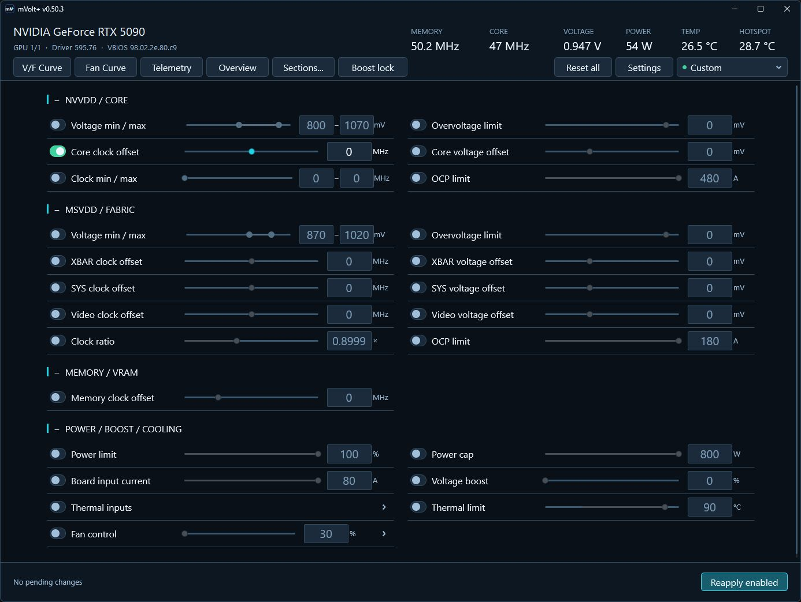

### Tuning Overview — v0.50.1

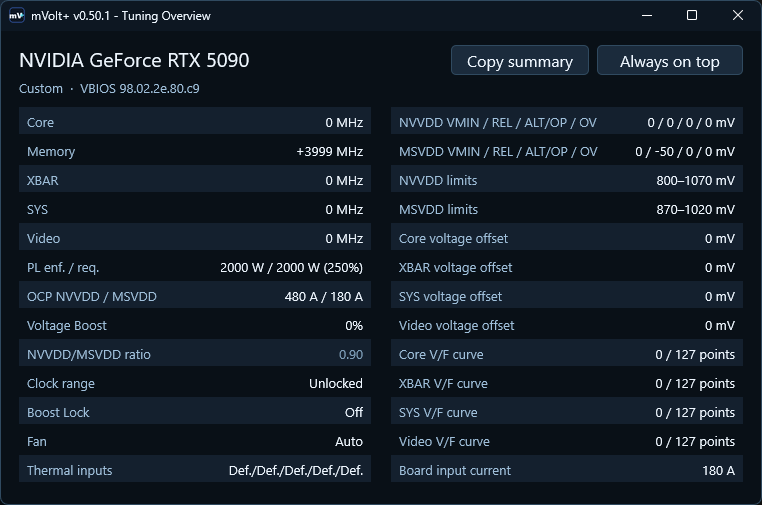

<details>
<summary><strong>Standard dashboard and Profile Manager</strong></summary>

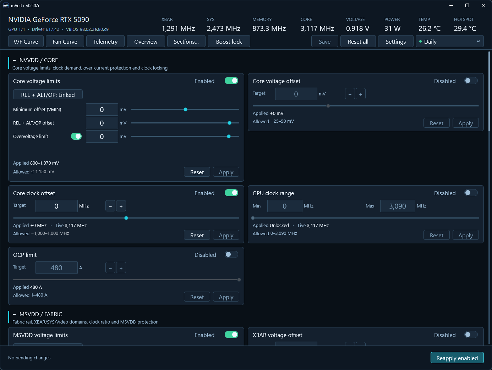

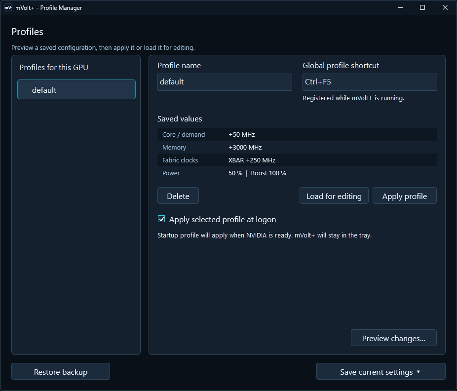

</details>

<details>
<summary><strong>Fan controllers</strong></summary>

**mVolt software curve**

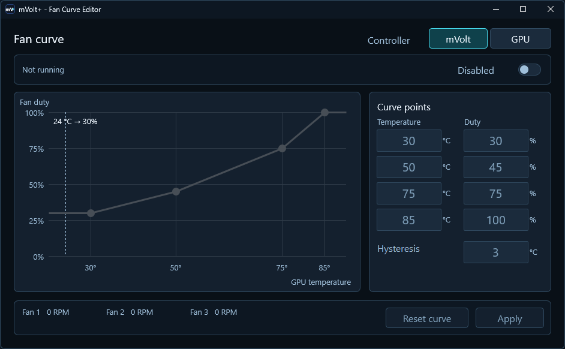

**GPU fan policy — experimental**

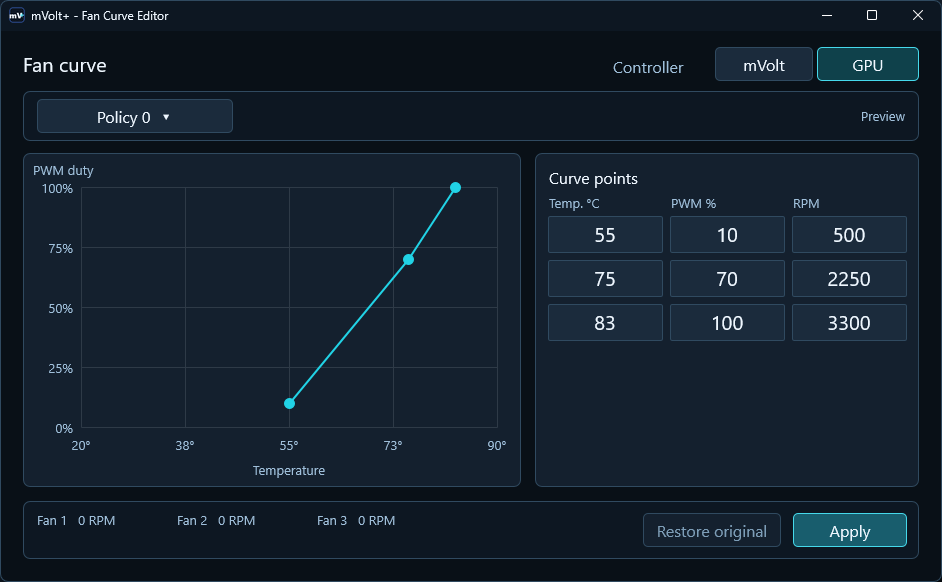

</details>

<details>
<summary><strong>V/F editor and extended limits</strong></summary>

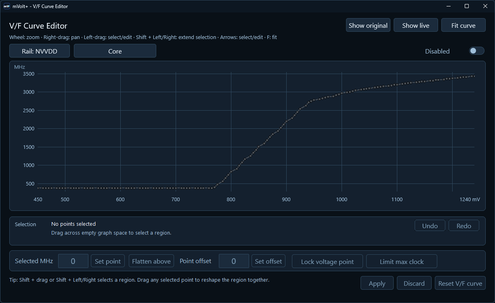

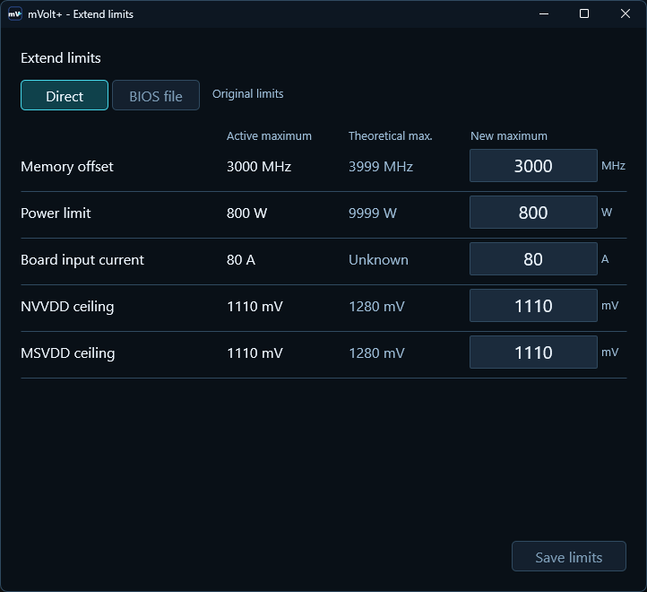

</details>

<details>
<summary><strong>Telemetry, temperatures and GPU info</strong></summary>

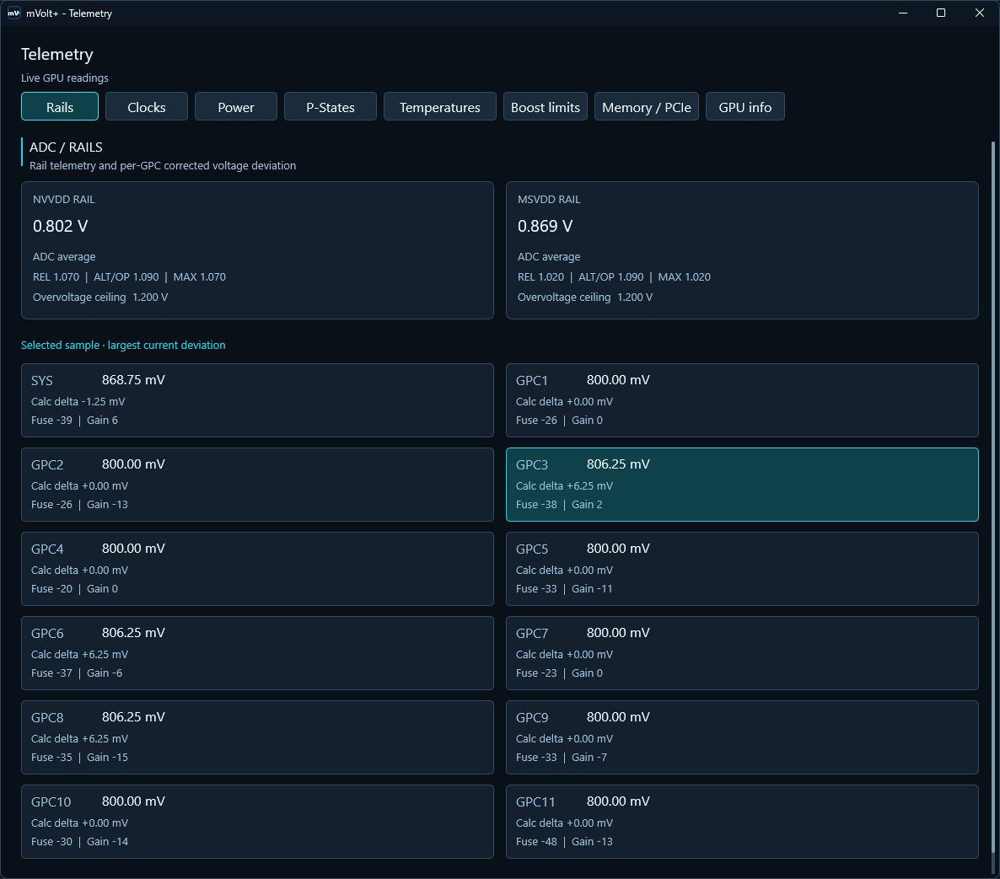

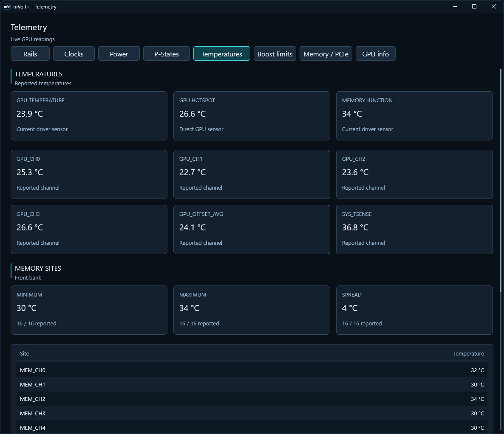

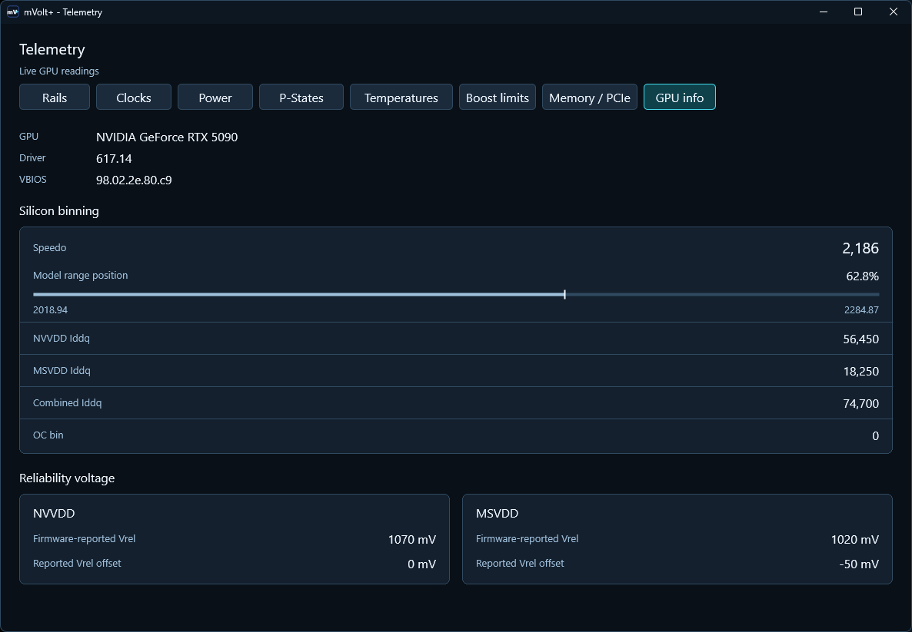

</details>

## Requirements

- 64-bit Windows with an NVIDIA display driver.
- Administrator privileges for tuning.
- Working NVML support for GPU clock-range control and NVML telemetry.
- RivaTuner Statistics Server only for the optional overlay.

mVolt+ is an independent third-party project, not affiliated with or endorsed
by NVIDIA. NVIDIA, GeForce and RTX are trademarks of NVIDIA Corporation.

## Credits

Thanks to [Loong0x00](https://github.com/Loong0x00) for discovering the XBAR clock control.
